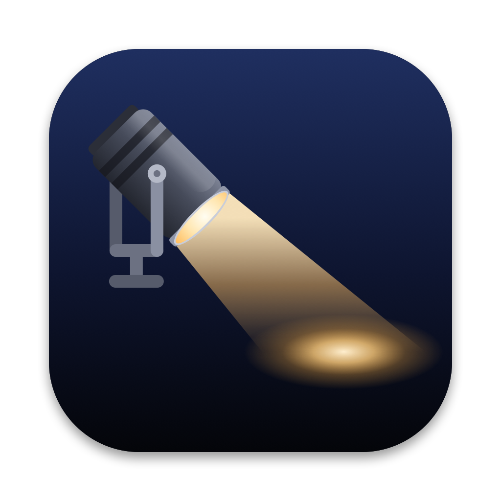

<p align="center"></p>

<h1 align="center">Lights Bridge</h1>

<p align="center">Run your lighting cues from ProPresenter slides.</p>

<p align="center">
  <a href="https://github.com/sethburt6/lights-bridge/actions/workflows/ci.yml"></a>
  <a href="https://github.com/sethburt6/lights-bridge/releases/latest"></a>
  <a href="LICENSE"></a>
  
</p>

Lights Bridge is a tiny Mac menu-bar app. When a ProPresenter slide sends a MIDI note, it turns that
into a "go to cue" message for an ETC Expression-family lighting board. It was built for an
Expression 3 at a church, but nothing in it is specific to one venue.

## Download

[Download the latest LightsBridge.dmg](https://github.com/sethburt6/lights-bridge/releases/latest/download/LightsBridge.dmg),
or see the [releases page](https://github.com/sethburt6/lights-bridge/releases/latest) for install
steps. It works on Intel and Apple Silicon Macs, macOS 11 or newer.

## How it works

ProPresenter sends a MIDI Note On to the "Lights Bridge" device. Lights Bridge converts it to a Program
Change with the same number and sends it down a USB-MIDI cable to the board's MIDI IN.

```
ProPresenter  -->  Lights Bridge  -->  USB-MIDI cable  -->  board MIDI IN
 (Note On N)       (Program Change N)
```

| ProPresenter sends               | Lights Bridge sends to the board          |
|----------------------------------|-------------------------------------------|
| Note On, note N, velocity 1-127  | Program Change N on the board channel     |
| Note On, velocity 0              | nothing (that means "note off")           |
| Note Off                         | nothing                                   |
| Anything else                    | nothing                                   |

- N is 0 to 127. Note 0 means "GO next cue" on the board.
- The input channel doesn't matter. The output channel and a cue number offset (default 0) are set in
  Settings.

## Setup and help

- Setup (one time): [docs/SETUP.md](docs/SETUP.md)
- Something not working on Sunday? [docs/VOLUNTEER.md](docs/VOLUNTEER.md)

## For maintainers

```
scripts/build.sh                # universal app and dist/LightsBridge.dmg (--arm64-only for a quick build)
scripts/test.sh                 # unit tests

LIGHTSBRIDGE_DEV=1 .build/debug/LightsBridge &   # end-to-end: run the app without installing it
swift run SelfTest                               # then check it against the running app
```

To release: bump `VERSION`, add a section to `CHANGELOG.md`, commit, then `git tag vX.Y.Z && git push origin vX.Y.Z`.
GitHub Actions builds the dmg and publishes the release page.

No third-party code; only Apple frameworks. See [ARCHITECTURE.md](ARCHITECTURE.md) for how it is put
together and [CHANGELOG.md](CHANGELOG.md) for what changed in each version.
The log is at `~/Library/Logs/LightsBridge.log`.

## Safety

Lights Bridge only sends "go to cue" messages; it never changes anything stored on the board. Always
be ready to run the board by hand. It is provided as-is, with no warranty (see LICENSE).

## License and trademarks

MIT License, see [LICENSE](LICENSE). Not affiliated with or endorsed by Renewed Vision (ProPresenter)
or Electronic Theatre Controls (ETC, Expression). Trademarks belong to their owners.
